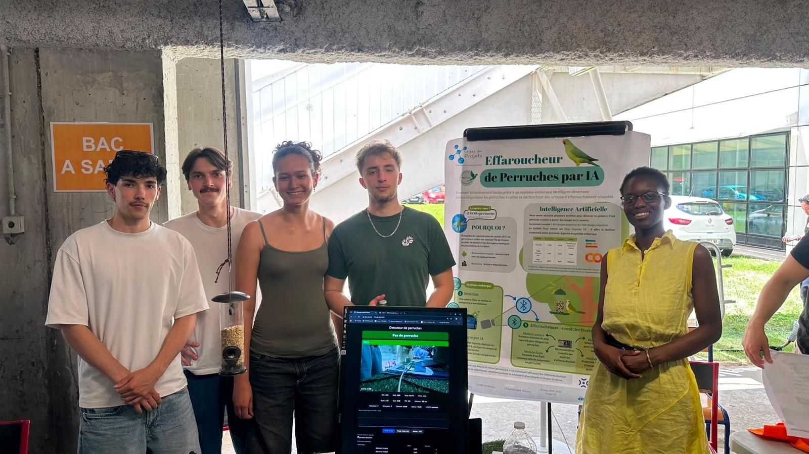

# Paraway — partie IA

Reconnaissance de la **perruche à collier** (*Psittacula krameri*) sur les images d'une caméra, pour **Paraway**, un effaroucheur de perruches autonome.

Contexte : projet E3 de l'ESIEE Paris, promo 2025-2026, présenté à la Journée des projets le 26 juin 2026.

> **Ce dépôt ne contient que la partie IA**, du dataset au modèle final.
> Le système embarqué (Arduino UNO Q, caméra, filtre anti-faux-positifs, dashboard, BLE, ESP32 son et vibration) se trouve dans le dépôt
> **[3gol1ft/parakeet-scarer](https://github.com/3gol1ft/parakeet-scarer)**.

---

## Sommaire

1. [Le besoin](#1-le-besoin)
2. [Le dataset](#2-le-dataset)
3. [Les modèles testés](#3-les-modèles-testés)
4. [Résultats et choix final](#4-résultats-et-choix-final)
5. [Déploiement sur l'Arduino UNO Q](#5-déploiement-sur-larduino-uno-q)
6. [Structure du dépôt](#6-structure-du-dépôt)
7. [Reproduire](#7-reproduire)
8. [Limites et perspectives](#8-limites-et-perspectives)
9. [Équipe et crédits](#9-équipe-et-crédits)

---

## 1. Le besoin

Une caméra filme une mangeoire. L'IA doit répondre à une seule question : **y a-t-il une perruche à collier sur l'image ?**

On a donc choisi une **classification binaire** (`perruche` / `pas_perruche`), et pas une détection d'objets avec boîtes englobantes :

- la caméra regarde une zone réduite, la position exacte de l'oiseau ne sert à rien pour déclencher l'effarouchement ;
- un classifieur est plus léger, donc plus simple à faire tourner sur une carte embarquée ;
- il n'y a aucune annotation de boîtes à faire.

## 2. Le dataset

| Classe | Images | Contenu |
|---|---|---|
| `perruche` | 5 281 | Perruches à collier (iNaturalist, photos fournies par notre encadrant, images trouvées sur Internet), plus des images augmentées |
| `pas_perruche` | 3 002 | Oiseaux d'Île-de-France, psittacidés proches et décors typiques autour d'une mangeoire |
| **Total** | **8 283** | Découpage 70 % train / 15 % validation / 15 % test (graine fixe 42) |

### Des négatifs choisis pour piéger le modèle

Un modèle qui n'a vu que des perruches et des fonds unis répond « perruche » dès qu'il voit du vert. Les négatifs ont donc été collectés par catégories (script [`dataset/collect_dataset.py`](dataset/collect_dataset.py)) :

- **oiseaux courants en Île-de-France** : merle, moineau, pigeons ramier et biset, corneille, pie bavarde, mésanges, verdier, pinson, rouge-gorge, étourneau, pics, tourterelle turque… ;
- **psittacidés qui ressemblent à la perruche à collier** (les plus gros risques de faux positifs) : perruche moine, perruche alexandre, amazone verte, conure soleil, cacatoès ;
- **décors** : parcs urbains, feuillage, haies, ciel à travers les branches, sous-bois, berges, rues, ciel nuageux.

Sources : iNaturalist (observations de qualité « recherche », zone Île-de-France), GBIF, Wikimedia Commons et Unsplash. Le script garde la licence de chaque image, écarte les licences « ND » (pas de modification autorisée) et supprime les doublons grâce à un hash MD5.

Le fichier [`dataset/sources_negatives.csv`](dataset/sources_negatives.csv) liste pour chaque image négative collectée : la source, la licence et l'URL d'origine.

> **Les images ne sont pas incluses dans ce dépôt.** La plupart sont sous licence CC BY-NC, qui impose l'attribution. Le CSV et le script permettent de retrouver ou de reconstruire le dataset.

### Prétraitement et augmentation

- [`dataset/recuperation_inaturalist_128x128.ipynb`](dataset/recuperation_inaturalist_128x128.ipynb) : récupération d'images depuis l'API iNaturalist et passage en 128 × 128.
- [`dataset/data_augmentation.ipynb`](dataset/data_augmentation.ipynb) : augmentation des images positives avec Albumentations, pour équilibrer et diversifier la classe `perruche`.

## 3. Les modèles testés

On a suivi deux pistes : un **CNN entraîné de zéro** (Keras), puis importé dans Edge Impulse pour le déploiement, et **YOLO26 en mode classification**, pré-entraîné sur ImageNet (transfer learning).

### CNN maison (TensorFlow / Keras, images 128 × 128)

| Version | Notebook | Architecture | Paramètres | Accuracy test |
|---|---|---|---|---|
| V1 | [`cnn/cnn_v1.ipynb`](cnn/cnn_v1.ipynb) | Conv2D + MaxPooling, augmentation intégrée (flip, rotation, zoom) | 3,3 M | 94,2 % |
| V2 | [`cnn/cnn_v2.ipynb`](cnn/cnn_v2.ipynb) | Version allégée pour l'embarqué | 97 k | 94,0 % |
| V3 | [`cnn/cnn_v3.ipynb`](cnn/cnn_v3.ipynb) | Conv2D + BatchNormalization, dataset enrichi | 793 k | **96,0 %** |

Chaque version est exportée en TensorFlow Lite (`.tflite`) puis importée dans **Edge Impulse**, qui la compile en binaire `.eim` pour Linux ARM64.

### YOLO26 classification (Ultralytics, images 224 × 224)

Notebook : [`yolo/yolo26_classification.ipynb`](yolo/yolo26_classification.ipynb). Entraînement sur Google Colab (GPU T4), 50 epochs, évaluation sur 798 images de test.

| Modèle | Paramètres | Taille | Accuracy test |
|---|---|---|---|
| YOLO26n-cls (nano) | 1,5 M | 3,2 Mo | 97,4 % |
| YOLO26m-cls (medium) | 10,3 M | 20,9 Mo | 98,3 % |

Le nano perd moins d'un point par rapport au medium, avec 7 fois moins de paramètres. Il a été exporté au format **NCNN**, rapide sur CPU ARM : voir [`yolo/model_yolo26n_ncnn/`](yolo/model_yolo26n_ncnn/).

## 4. Résultats et choix final

| Modèle | Paramètres | Accuracy | Décision |
|---|---|---|---|
| YOLO26n | 1,5 M | 97,4 % | Fonctionnel, mais non retenu : plus lourd et plus complexe à intégrer |
| CNN V2 (Edge Impulse « test ») | 97 k | 94,0 % | Très léger, mais moins fiable |
| **CNN V3 (Edge Impulse « VF »)** | **793 k** | **96,0 %** | **Modèle final embarqué** |

**Pourquoi pas le meilleur score ?** Dans un système embarqué, la précision n'est pas le seul critère. Le CNN V3 compilé par Edge Impulse :

- s'intègre directement au pipeline Python de la carte grâce au SDK `edge-impulse-linux` ;
- prend en entrée des images 128 × 128, donc moins de calcul par image (environ 126 ms par inférence, 6 à 7 images par seconde sur l'UNO Q) ;
- garde une très bonne précision, à 1,4 point du YOLO nano.

L'écart avec YOLO s'explique en partie par le **transfer learning** : YOLO part de poids pré-entraînés sur ImageNet, alors que notre CNN part de zéro.

## 5. Déploiement sur l'Arduino UNO Q

Le modèle final (`perruche.eim`) tourne sur la partie Linux de l'Arduino UNO Q :

1. capture de l'image par la webcam ;
2. redimensionnement en 128 × 128 par étirement (*squash*), la même transformation qu'à l'entraînement ;
3. inférence, qui renvoie un score `perruche` entre 0 et 1 ;
4. filtre anti-faux-positifs (seuil, fenêtre glissante, hystérésis), puis envoi de l'ordre BLE aux modules d'effarouchement.

Les étapes 1, 3 et 4 font partie du système embarqué. Leur code et leur documentation complète sont dans **[3gol1ft/parakeet-scarer](https://github.com/3gol1ft/parakeet-scarer)**.

## 6. Structure du dépôt

```
paraway-ia/
├── dataset/
│   ├── collect_dataset.py                    # collecte des négatifs par catégories (iNaturalist, GBIF, Wikimedia, Unsplash)
│   ├── sources_negatives.csv                 # source + licence + URL de chaque image négative
│   ├── recuperation_inaturalist_128x128.ipynb
│   └── data_augmentation.ipynb
├── cnn/
│   ├── cnn_v1.ipynb                          # 3,3 M paramètres, 94,2 %
│   ├── cnn_v2.ipynb                          # 97 k paramètres, 94,0 %
│   └── cnn_v3.ipynb                          # 793 k paramètres, 96,0 % : modèle final
├── yolo/
│   ├── yolo26_classification.ipynb           # YOLO26n / YOLO26m, comparaison et export
│   └── model_yolo26n_ncnn/                   # YOLO26n exporté en NCNN
└── models/
    └── cnn_v2.tflite                         # CNN V2 au format TensorFlow Lite
```

## 7. Reproduire

Les notebooks ont été exécutés sur **Google Colab**. Ils contiennent encore leurs sorties : on peut lire les résultats sans rien relancer.

1. **Construire les négatifs** (Python 3, `requests` et `Pillow`) :
   ```bash
   python dataset/collect_dataset.py --output ./dataset2 --per-category 100
   ```
2. **Préparer les positifs** avec `recuperation_inaturalist_128x128.ipynb`, puis `data_augmentation.ipynb`.
3. **Entraîner** : ranger les images dans `dataset/perruche/` et `dataset/pas_perruche/`, puis lancer `cnn/cnn_v3.ipynb`. Le découpage train / val / test se fait dans le notebook.
4. **Déployer** : importer le `.tflite` obtenu dans un projet Edge Impulse (*Upload your model*), puis compiler pour *Linux (AARCH64)* afin d'obtenir le `.eim`.
5. **Comparer avec YOLO** : zipper le dossier `dataset_split/`, puis lancer `yolo/yolo26_classification.ipynb` sur Colab avec un GPU.

## 8. Limites et perspectives

- **Tests réalisés sur photos imprimées**, pas sur de vraies perruches en extérieur. Il reste à valider le modèle avec une lumière variable, des arrière-plans complexes et d'autres oiseaux.
- **Détection de jour seulement** : la nuit et la faible luminosité ne sont pas traitées.
- **Boucle d'amélioration du dataset** : stocker les images détectées, les vérifier à la main (vrais positifs, faux positifs, cas limites), puis réentraîner.
- **Détection acoustique des cris de perruches** : n'allumer la caméra qu'en cas de présence probable, pour économiser l'énergie.

## 9. Équipe et crédits

Projet **Paraway**, réalisé par une équipe de cinq étudiants de l'ESIEE Paris (E3, 2025-2026) et encadré par Thierry Grandpierre.

<p align="center">
  
  <br>
  <em>L'équipe Paraway à la Journée des projets, le 26 juin 2026</em>
</p>

| Partie | Où la trouver |
|---|---|
| Intelligence artificielle | ce dépôt |
| Système embarqué, communication BLE, effarouchement | [3gol1ft/parakeet-scarer](https://github.com/3gol1ft/parakeet-scarer) |

Les contributeurs de ce dépôt apparaissent dans l'onglet *Contributors* de GitHub.

**Crédits images :** iNaturalist, GBIF, Wikimedia Commons et Unsplash (voir `dataset/sources_negatives.csv`), plus les photos de perruches fournies par Thierry Grandpierre.

**Licence des modèles YOLO :** les poids YOLO26 viennent d'Ultralytics et sont soumis à la licence [AGPL-3.0](https://ultralytics.com/license).
